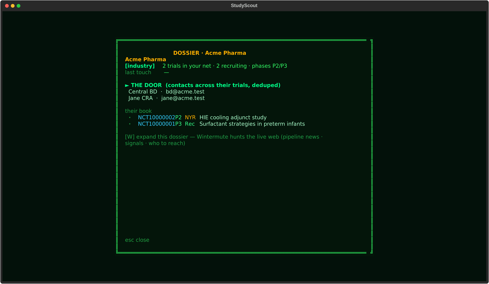
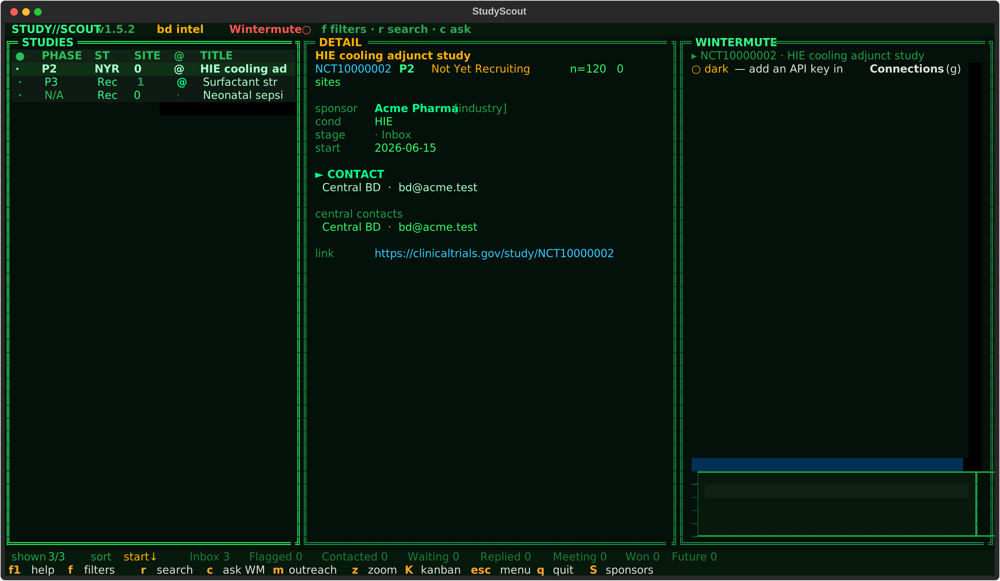
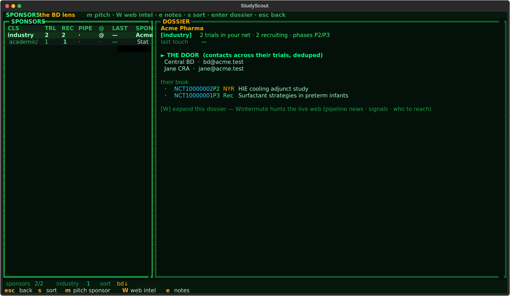

# STUDY//SCOUT

**A phosphor-green terminal for clinical-trials business development.**

Site BD is *sponsor-relationship* work — but every tool treats it as
listing-search. STUDY//SCOUT flips the unit of work: it hunts
[ClinicalTrials.gov](https://clinicaltrials.gov) for studies that fit your
research site, then regroups everything into **one dossier per sponsor** —
their whole book of trials, contacts deduped across NCTs, your pipeline
history, your notes, and (optionally) live web intel — because the outreach
unit is the relationship, not the NCT number.

Built by a clinician who runs site BD, for people who do the job.



<details>
<summary>More screens — the deck and the sponsor lens</summary>





</details>

*(Screens above are the test-fixture data the smoke suite generates — no real
sponsors were harmed.)*

## What it does

- **Hunt** — ClinicalTrials.gov v2 API (public, keyless): condition, keyword
  OR-net, phase/age/funder/status checklists, geography, site count.
- **Deck** — every catch in a sortable phosphor table; column-header sorting,
  full-table zoom, text filter, stale-row hygiene (rows the latest search
  no longer catches hide automatically — never deleted).
- **Sponsor dossiers** — one row per relationship: trials, deduped contacts
  (the same human often guards several NCTs — that's the door), last touch,
  notes. One key drafts a **consolidated multi-trial pitch**.
- **Expanded dossier** — Wintermute (Claude) searches the live web for the
  sponsor: pipeline news, readouts, deals, who runs site selection. The intel
  is dated, stored on the relationship, and folded into the next pitch.
- **Pipeline board** — a dedicated kanban of worked stages (inbox stays on
  the deck), including a **FUTURE OUTREACH** column for "call us when the
  next study comes" relationships — with a keep-warm nudge in the morning
  briefing when they've been parked too long.
- **Morning briefing** — new trials in your net, status flips (the
  excuse-to-email feed), quiet relationships, reg-paperwork nags, top 3 moves.
- **Field maintenance** — `studyscout doctor` (pre-flight diagnostic),
  `studyscout backup`/`restore` (your BD memory in one tarball).

**Design stance:** no fit scoring, on purpose. You rank fits in your head —
the tool's job is to put everything about a sponsor in front of you at once.
And the house law throughout: **the LLM proposes, deterministic code
verifies, you confirm.** The AI never touches your pipeline uninvited.

## AI is optional

No API key → search, deck, dossiers, board, and briefing all work
(rules-only). Add an [Anthropic API key](https://console.anthropic.com) →
Wintermute lights up: outreach drafting, consolidated pitches, web-hunted
sponsor intel, chat.

## Install

```bash
# from source (Python 3.11+)
python3 -m venv .venv
.venv/bin/pip install textual anthropic httpx platformdirs tomli-w
PYTHONPATH=src .venv/bin/python -m studyscout

# or build the self-contained Fedora RPM (bundles its own Python)
bash packaging/build_rpm.sh
sudo dnf install ./dist/rpm/RPMS/x86_64/studyscout-*.rpm
```

First run seeds `~/.config/studyscout/profile.toml` and `site.md` — describe
your site honestly; Wintermute pitches from it. Then `f` to set your search
(condition + your therapeutic keyword net), `r` to hunt, `S` for dossiers.
Full manual: [HANDBOOK.md](HANDBOOK.md).

## Disclaimers

Not affiliated with ClinicalTrials.gov / NLM. Outreach drafts are drafts —
a human reads and sends them. MIT licensed; see [LICENSE](LICENSE).
